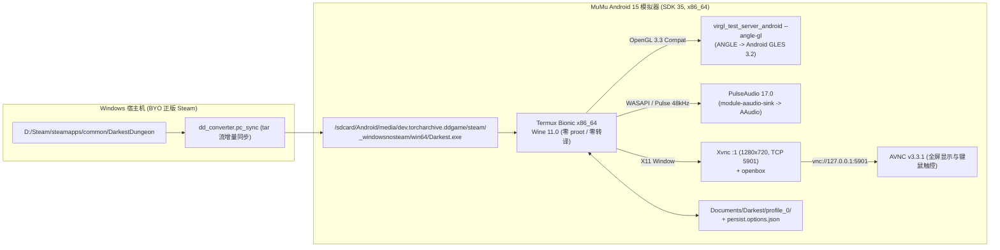

# 路线 C（v3.0）阶段 M0：MuMu Android 15 模拟器实测与复现指南

> 返回导航：[工作区总索引](../INDEX.md) · [路线 C 总体规划](ROUTE-C-PURE-STEAM-PLAN.md) · [M0 基准数据报告](M0-BENCHMARK.md)
> 适用范围：Windows 宿主机 + MuMu Android 15 模拟器（`x86_64` + `houdini64`）+ 正版 Steam《暗黑地牢》

---

## 1. 实测结论速览

本指南记录了如何在 **MuMu Android 15 模拟器**上，**零 Wicked APK、零 ASTC 转码、零 `.ogv` 转码**，仅凭个人正版 Steam 目录（`_windowsnosteam/win64/Darkest.exe`）与 100% 开源兼容栈完整跑通《暗黑地牢》。

- **图形性能**：采用 **`VirGL (--angle-gl) + MESA_GL_VERSION_OVERRIDE=3.3COMPAT + MESA_GLSL_VERSION_OVERRIDE=330`**，主菜单实测 **`79–103 FPS`**（峰值 `110.9 FPS`），「老路」战斗 **`82–92 FPS`**（全中文战斗 `91.8 FPS`），较 `llvmpipe` 纯软渲染（`10.3 FPS`）提速约 **10 倍**。
- **启动与内存**：首次 `wineboot --init` `18 s`，二次热启动至游戏窗口映射 **`1.80–1.91 s`**；战斗峰值 RSS：`Darkest.exe` `~1.27 GiB`，`virgl_test_server_android` `~638 MiB`；连续运行 **> 13 分钟**零崩溃。
- **完整生态验证**：简体中文位图字体（「战役」「老路」「十字军」「精准/暴击/伤害…」）、2D 骨骼动画、火把与高斯模糊着色器、鼠标 Hover 抗性面板、2 款正版 DLC（`Musketeer` / `Shieldbreaker`）、FMOD 双路 `48 kHz / 44.1 kHz` → Android `AAudio_sink` 音频、标准 DSON 存档 `profile_0/` 全部一次通过。

---

## 2. 实测链路架构图



---

## 3. 从零复现步骤

### 3.1 启动 MuMu Android 15 实例并连接 ADB

```powershell
$mgr = "D:\Program Files\Netease\MuMu\nx_main\MuMuManager.exe"
& $mgr control -v 3 launch
& $mgr info -v 3   # 读取 adb_port，例如 16480
adb connect 127.0.0.1:16480
```

### 3.2 裁剪并同步纯 64 位正版 Steam 目录（`T0.2`）

```powershell
$env:PYTHONPATH = "d:\暗黑地牢apk\dd-steam-converter"
python -m dd_converter.pc_sync --dry-run
python -m dd_converter.pc_sync --serial 127.0.0.1:16480
```

- 自动排除 `_windows/`、`_windowsnosteam/win32/`、`shaders_d3d11/`、`shaders_xb1/`、`app.log*`、`steam_appid.txt`（节省 `132.0 MB`）。
- 首次全量 `8,599` 文件（`2,087.3 MB`）经无压缩 tar 流直传解压耗时约 `78 s`；后续二次增量校验仅 `1.1 s`。

### 3.3 安装开源客户端（不入 Git，存于 `dist/runtime-poc/`）

从对应 GitHub 官方 Release 拉取并安装以下开源 APK：
- `termux-app_v0.118.3+github-debug_x86_64.apk`（`termux/termux-app`）
- `AVNC-3.3.1.apk`（`gujjwal00/avnc`）

授予 `com.termux` 外部存储权限：

```powershell
adb -s 127.0.0.1:16480 shell "appops set com.termux MANAGE_EXTERNAL_STORAGE allow"
```

### 3.4 在 Termux (`x86_64`) 中安装 Bionic Wine 11.0 与图形/音频依赖

先启动一次 `com.termux` 完成 bootstrap，然后通过 `adb shell run-as com.termux` 安装：

```bash
export PREFIX=/data/data/com.termux/files/usr
export HOME=/data/data/com.termux/files/home
export PATH=$PREFIX/bin:$PATH
export DEBIAN_FRONTEND=noninteractive

pkg install -y x11-repo
apt-get update -y
apt-get install -y libc++ termux-x11-nightly wine-stable mesa mesa-demos \
  virglrenderer-android vulkan-loader-android vulkan-tools \
  pulseaudio tigervnc openbox xdotool procps

# Android 8+ 切换 PulseAudio 默认输出至 AAudio
sed -i 's/module-sles-sink/module-aaudio-sink/g' "$PREFIX/etc/pulse/default.pa"

# 首次初始化最小 Wine Prefix（仅需一次，约 18s）
export WINEPREFIX=$HOME/.wine-dd-m0
$PREFIX/opt/wine-stable/bin/wineboot --init
```

### 3.5 一键启动脚本（在 Termux 终端进程中执行）

将以下脚本保存至 `~/run_dd_mumu.sh` 并 `chmod +x`：

```bash
#!/data/data/com.termux/files/usr/bin/bash
export PREFIX=/data/data/com.termux/files/usr
export HOME=/data/data/com.termux/files/home
export TMPDIR=$PREFIX/tmp
export PATH=$PREFIX/bin:$PREFIX/opt/wine-stable/bin:$PATH
unset LD_LIBRARY_PATH
export WINEPREFIX=$HOME/.wine-dd-m0
export DISPLAY=:1

# 关键渲染环境变量：ANGLE-GL 硬件加速 + OpenGL 3.3 兼容 + GLSL 330
export GALLIUM_DRIVER=virpipe
export MESA_GL_VERSION_OVERRIDE=3.3COMPAT
export MESA_GLSL_VERSION_OVERRIDE=330
export GALLIUM_HUD=simple,fps
export WINEDEBUG=err+all,fixme-all

# 清理残留进程
wineserver -k 2>/dev/null || true
pkill -9 -f Darkest.exe 2>/dev/null || true
pkill -9 -f Xvnc 2>/dev/null || true
pkill -9 -f openbox 2>/dev/null || true
pkill -9 -f virgl_test_server_android 2>/dev/null || true
pkill -9 -f pulseaudio 2>/dev/null || true
rm -f "$TMPDIR/.X1-lock" "$TMPDIR/.X11-unix/X1"
sleep 1

# 1. 启动 PulseAudio（启动前不可设置 PULSE_SERVER）
unset PULSE_SERVER
pulseaudio --start \
  --load="module-native-protocol-tcp auth-ip-acl=127.0.0.1 auth-anonymous=1" \
  --exit-idle-time=-1
export PULSE_SERVER=127.0.0.1

# 2. 启动 VirGL ANGLE-GL 硬件渲染服务端 + Xvnc + openbox
nohup virgl_test_server_android --angle-gl >"$TMPDIR/virgl.log" 2>&1 </dev/null &
nohup Xvnc :1 -geometry 1280x720 -depth 24 -SecurityTypes None -AlwaysShared -ac -rfbport 5901 >"$TMPDIR/xvnc.log" 2>&1 </dev/null &
sleep 2
nohup openbox >"$TMPDIR/openbox.log" 2>&1 </dev/null &
sleep 1

# 3. 拉起官方 64 位无 Steam DRM 主程序
cd /sdcard/Android/media/dev.torcharchive.ddgame/steam/_windowsnosteam/win64
nohup wine Darkest.exe -size 1280 720 -skip >"$HOME/dd_launch.log" 2>&1 </dev/null &
```

在 Termux 终端中执行 `bash ~/run_dd_mumu.sh`，随后通过 Intent 打开 AVNC 直连画面：

```powershell
adb -s 127.0.0.1:16480 shell "am start -a android.intent.action.VIEW -d 'vnc://127.0.0.1:5901'"
```

### 3.6 预设简体中文与分辨率（`persist.options.json` 实测结构）

游戏实际读取的配置路径为 `$WINEPREFIX/drive_c/users/<user>/Documents/Darkest/persist.options.json`，关键字段结构如下：

```json
{
  "version": 1,
  "data": {
    "values": {
      "fullscreen": [1],
      "resolution": [1280, 720],
      "language": "schinese",
      "blur": [1],
      "master_volume": [100]
    }
  }
}
```

> [!IMPORTANT]
> 外层必须包含 `"data"` 键，且 `"language"` 的值是纯字符串（如 `"schinese"`）而非数组；其余开关与数值为单元素或双元素 JSON 数组。

---

## 4. 实测避坑录（6 条关键工程经验）

| # | 现象 / 报错 | 根因定位 | 解决方案与 M1 架构启示 |
| :---: | :--- | :--- | :--- |
| **1** | `Winlator 11.2` 在 MuMu 启动容器秒退：`CANNOT LINK EXECUTABLE "/system/bin/houdini64": ".../libc.so" has bad ELF magic: 2f2a2047` | Winlator 对 glibc `box64` 设置 `LD_LIBRARY_PATH`，被 `x86_64` 模拟器的 Bionic `/system/bin/houdini64` 误读取 | M1 真机主引擎首选 **纯 Android Bionic 编译的 Wine 10 ARM64EC + FEXCore**（如 `proton-10-arm64ec`），直接链接 `/system/bin/linker64`，零 glibc 污染 |
| **2** | `Termux:X11` 始终显示 `Not connected` | `dumpsys activity broadcasts` 捕获 MuMu 明确拦截第三方跨包静态广播：`Skipping delivery to com.termux.x11 blocked by mumu` | M0 模拟器改用纯 TCP 环回 `Xvnc + AVNC`；M1 自研同 UID/同应用嵌入式 `SurfaceView` 桥接，彻底杜绝跨包广播限制 |
| **3** | `VirGL` 默认无参启动后画面全黑（仅见游戏手绘光标） | 默认 `virgl_test_server_android` 仅暴露 OpenGL `2.1`，无法正常回读游戏 FBO | 改为 `virgl_test_server_android --angle-gl` 并设置 `MESA_GL_VERSION_OVERRIDE=3.3COMPAT` 与 `MESA_GLSL_VERSION_OVERRIDE=330`，画面瞬间点亮并飙至 `88–103 FPS` |
| **4** | 给 Termux 脚本设置 `LD_LIBRARY_PATH=$PREFIX/lib` 后 `virgl` 渲染断连 | 覆盖了 Android 系统 EGL/Vulkan 链接器路径，导致 `virgl_test_server_android` 崩溃 | 显式 `unset LD_LIBRARY_PATH`（Termux 二进制自带 `DT_RUNPATH`） |
| **5** | `pulseaudio --start` 报 `User-configured server at 127.0.0.1, refusing to start` | 启动服务端前预先导出了 `PULSE_SERVER=127.0.0.1` | 先 `unset PULSE_SERVER` 完成 `pulseaudio --start`，再为 Wine 导出 `PULSE_SERVER=127.0.0.1` |
| **6** | `adb shell run-as com.termux` 读取 `/sdcard/...` 报 `Permission denied` | Android 11+ `run-as` 继承 ADB mount namespace，看不到 Zygote FUSE 外部存储挂载 | 启动脚本须在应用自身 Zygote 进程上下文运行（M1 封装在 `:pcgame` 独立子进程中天然无此问题） |

---

## 5. M1 阶段架构交接清单

M0 全部门禁已绿灯通过，进入 M1（`T1.1`–`T1.3`）时直接复用以下锁定结论：

1. **运行时选型**：ARM64 真机主路线为 **Android Bionic Wine 10 ARM64EC + FEXCore（MIT）**，备选 **Box64 + Wine64**。
2. **多 GPU 渲染策略**：
   - Adreno 真机：`Turnip + Zink`；
   - 非骁龙 / 模拟器通用硬件加速：`VirGL (--angle-gl) + MESA_GL_VERSION_OVERRIDE=3.3COMPAT + MESA_GLSL_VERSION_OVERRIDE=330`；
   - 极端兜底：`System Vulkan + Zink` / `GL4ES`。
3. **启动参数与路径约定**：
   - 主程序：`<steam>/ _windowsnosteam/win64/Darkest.exe -size <W> <H> -skip`；
   - 存档目录映射：Wine `Documents/Darkest/` ↔ 应用沙盒 `files/pc/save/`（直接兼容现有 `DsonCodec`、`SaveEditor` 与 `SnapshotStore`）；
   - 语言与分辨率预写：通过 `persist.options.json` 精准同步 `DisplayConfig` 分辨率与默认简体中文。
