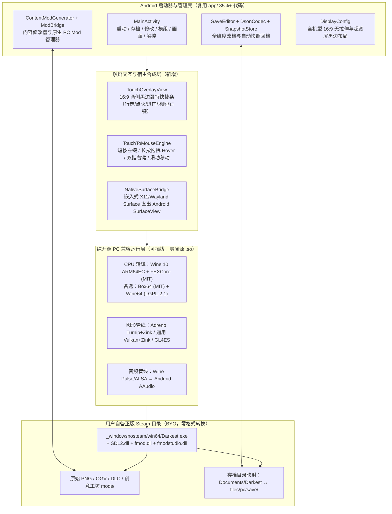

# 路线 C 架构与实施规划：纯正版 Steam《暗黑地牢》安卓开源运行方案（v3.0）

> 返回导航：[工作区总索引](../INDEX.md) · [项目总览](../README.md) · [v2.0 系统架构](ARCHITECTURE.md) · [修改器指南](MODIFIER-GUIDE.md) · [构建与测试](BUILD-AND-TEST.md)

## 1. 战略目标与核心价值

v2.0 架构已经验证了「一体化启动器 + 存档快照 + 全维度 DSON 存档/内容修改器 + Mod 管理」的产品体验，但受限于底层运行核心，用户仍必须额外自备特定 SHA-256 版本的第三方闭源 Wicked 2.2.2 APK。

**路线 C（v3.0）的核心目标**是：

1. **彻底消除 Wicked 2.2.2 APK 与任何 Switch 文件依赖**：普通玩家只需拥有**个人合法购买的正版 Steam PC 版《暗黑地牢》**，即可在安卓手机/平板上完整游玩。
2. **100% 开源、合规、可持续演进**：底层全部采用成熟开源兼容栈（Wine + FEXCore/Box64 + Mesa Zink/Turnip/GL4ES + 原生 Surface 合成），仓库与 Release 均零闭源第三方二进制、零商业游戏资产。
3. **最大化复用现有成果**：直接保留并复用 v2.0 已经过真机验证的 Android 启动器 UI（`MainActivity` / `ModifierSection`）、无损 DSON 编解码器（`DsonCodec`）、全维度存档修改器（`SaveEditor`）、非破坏性内容修改器（`ContentModGenerator`）、自动快照系统（`SnapshotStore`）和分辨率控制器（`DisplayConfig`）。
4. **原生 100% PC 生态兼容**：无需 ASTC 纹理转码、无需 `.ogv → .mp4` 视频转码、无需重建 23 份 `filelist.csv`，直接原生运行 PC 端全部 DLC 与海量 Steam 创意工坊 Mod。

---

## 2. 基于真实 Steam 二进制的技术勘测结论

对本机正版 Steam 目录（`DarkestDungeon`）进行实测拆解，发现其二进制结构极其适合路线 C：

| 勘测维度 | 实测结果 | 对安卓兼容层的重大利好 |
| :--- | :--- | :--- |
| **无 Steam 绑定 64 位主程序** | 官方正版目录直接自带 **`_windowsnosteam/win64/Darkest.exe`**（`19.27 MB`，PE32+ `x86_64`） | **免 Steam 客户端、免 Steamworks DRM 模拟、免 32 位 WoW64 兼容层**，直接以纯 64 位进程启动 |
| **第三方 DLL 依赖面** | 仅 3 个非系统 DLL：`SDL2.dll`（1.63 MB）、`fmod.dll`（1.90 MB）、`fmodstudio.dll`（1.58 MB），全部为 `x64` | 依赖极简，无反作弊、无 .NET/JVM 运行时、无复杂中间件 |
| **系统 API 导入** | `KERNEL32`、`USER32`、`GDI32`、`ADVAPI32`、`SHELL32`、`OPENGL32`、`WINMM`、`WS2_32`、`WINHTTP`、`CRYPT32`、`MSVCP140`、`VCRUNTIME140` | 全为 Wine 最成熟的基础 Win64 API，无 DX11/DX12/VKD3D 负担 |
| **图形 API 与着色器** | 纯 **OpenGL 2.1 兼容模式**（全部 53 个 `.glsl` 着色器均为 `#version 120`，传统 2D 骨骼/贴图渲染） | 显卡压力极低：骁龙 Adreno 走 **Turnip + Zink** 轻松满帧 60 FPS；Mali/Xclipse/通用 GPU 可走 **系统 Vulkan + Zink** 或 **GL4ES**（OpenGL 2.1 → GLES3） |
| **输入与窗口框架** | 原生基于 **SDL2** 管理窗口、OpenGL 上下文、键盘/鼠标/手柄事件 | 支持在 Wine 侧或 Android 宿主侧精确注入鼠标悬停（Hover）、左/右键、滚轮与快捷键事件 |
| **官方命令行参数** | 内置 `-size`、`-disableaudio`、`-mod`、`-mod_profile`、`-skip` 等参数 | 便于启动器按 `DisplayConfig` 精确控制渲染分辨率与安全排障模式 |

---

## 3. 总体系统架构设计

### 3.1 分层架构图

### 3.2 核心技术选型说明

#### A. CPU 转译与 Windows 兼容层（双引擎策略）
1. **首选主路线：Wine 10.x ARM64EC + FEXCore（MIT）**
   - **原理**：ARM64EC 允许同一个 64 位进程内原生 ARM64 DLL 与 x86_64 PE 代码无缝混跑。Wine 的核心系统 DLL（`ntdll`、`kernel32`、`user32`、`gdi32`、`opengl32`、音频驱动）直接以**原生 ARM64** 执行，仅 `Darkest.exe` 自身 2D 游戏逻辑由 `libarm64ecfex.dll` JIT 转译。
   - **优势**：冷启动快、内存占用比纯 x64 Wine 显著更低、GPU/音频调用近乎零转译损耗；且无需依赖 32 位地址空间或特权 `proot`。
2. **成熟备选路线：Box64（MIT）+ Wine64（LGPL-2.1）**
   - **定位**：若特定安卓机型内核（如 16 KB 页大小或 SELinux 策略）与 ARM64EC 早期版本存在兼容边界，可一键切换至成熟的 Box64 + Wine64 组合（已在 Winlator/Mobox 社区大量真机验证）。

#### B. 图形渲染后端（按 GPU 自动探测）
- **第一优先级（高通 Adreno 6xx/7xx/8xx）**：**Mesa Turnip（开源 Vulkan 驱动）+ Mesa Zink（OpenGL 2.1 → Vulkan）**。完整支持 `#version 120` 兼容上下文，无驱动黑屏或字体花屏问题。
- **第二优先级（联发科 Mali/Immortalis、三星 Xclipse、其他支持 Vulkan 1.1+ 的设备）**：**系统原生 Vulkan + Mesa Zink**（通过 `VK_KHR_surface` / Android AHardwareBuffer 共享帧缓冲）。
- **第三优先级（老旧 GPU 或 Vulkan 扩展不全兜底）**：**GL4ES / VirGL**，将 OpenGL 2.1 直接翻译为 Android 原生 GLES 3.0，确保几乎所有 ARM64 安卓机都能点亮画面。

#### C. 音频后端
- `fmod.dll` / `fmodstudio.dll` 经 Wine WASAPI/WINMM 输出至内置轻量音频服务（PulseAudio/Socket → Android `AAudio`），实测延迟可控制在 40–60 ms 以内，且游戏切后台时自动静音暂停，不占用后台音频焦点。

#### D. 进程与目录隔离
- 保持 v2.0 的**同 UID 单应用多进程模型**：
  - 主进程：`MainActivity`（余烬启动器 UI、存档修改器、内容修改器、Mod 管理器）；
  - 游戏子进程（`:pcgame`）：承载 `SurfaceView`、触控映射层、兼容运行时进程树；主进程在执行改档、回档或切换 Mod 前强制回收 `:pcgame` 进程树，保证文件原子一致。

---

## 4. 触屏与移动设备交互专项设计（体验核心）

PC 版《暗黑地牢》原本针对键鼠设计，直接搬到手机上最大的障碍不是性能，而是**悬停提示（Hover）、右键操作与快捷键缺失**。路线 C 通过三层机制彻底解决：

### 4.1 智能触屏转键鼠引擎（`TouchToMouseEngine`）
- **单指短按（Tap）**：直接映射为对应游戏坐标的**鼠标左键点击**（选技能、攻击目标、拾取战利品、点击城镇建筑）。
- **单指按住并微移（Hold & Hover，> 180 ms）**：只移动虚拟光标、**不触发左键按下**——手指滑过英雄怪癖、技能图标、敌人血条、饰品与背包道具时实时弹出 PC 原生 Tooltip；松手即收起，彻底杜绝“想看说明结果误点了技能/扔掉道具”。
- **双指轻点 / 侧边右键键**：映射为**鼠标右键**（快速打开英雄详情面板、在地图/背包中使用补给品）。
- **地牢横滑手势（可选开关）**：在战斗外走廊区域单指水平拖动时自动转为按住 `A`（向左走）或 `D`（向右走），告别反复戳屏幕两侧边缘。
- **双指缩放 / 边缘防误触**：严格尊重 `DisplayConfig` 的挖孔避让区域，坐标按渲染画幅 `LAYER_W × LAYER_H` 精确反算，零偏移。

### 4.2 两侧黑边「余烬触控条」（充分利用 20:9 / 22:9 手机空闲空间）
现代安卓全面屏手机（如 `3168×1440`）按无拉伸 `16:9`（`2560×1440`）居中显示时，左右两侧天然各留出约 `304 px` 的黑边区域。路线 C 将其转化为**不遮挡 1 像素游戏画面的半透明哥特快捷控制栏**：
- **左侧栏**：`← 左行 (A)`、`→ 右行 (D)`、`进门/交互 (W)`、`右键模式切换 (R-Click)`；
- **右侧栏**：`点火把 (T)`、`地图/背包 (Tab)`、`跳过/返回 (Esc)`、`悬停窥视锁 (Hover)`、`快速暂停/截图`；
- **16:10 平板模式**：提供可折叠悬浮胶囊按钮，点击展开快捷条，平时几乎全隐形。

### 4.3 可选非破坏性「触屏字号/UI 舒适度 Mod」
- 沿用 `ContentModGenerator` 的非破坏性 Mod 机制，可选一键生成 `torch_touch_ui_comfort` 覆盖 Mod：仅微调极小字号与长列表滚动步长，不触碰任何原始游戏文件，随时可勾选开关。

---

## 5. 资源部署、存档与 Mod 零转换工作流

对比 v2.0（需在 PC 上转码 5,400+ 贴图并生成 4 GB `dd_assets.pak`），路线 C 的用户准备流程大幅简化：

| 环节 | v2.0（Switch 兼容路线） | 路线 C / v3.0（纯 Steam PC 路线） |
| :--- | :--- | :--- |
| **必需本地文件** | Wicked 2.2.2 APK + 正版 Steam | **仅需正版 Steam《暗黑地牢》** |
| **贴图处理** | 必须全量 PNG → ASTC 4×4 DDS | **零转换**（直接读取原版 PNG） |
| **视频/音频处理** | `.ogv → .mp4`、FSB5 音频回退 | **零转换**（原生播放 `.ogv` 与 PC `.bank`） |
| **索引重建** | 必须精确重建 23 份 `filelist.csv` | **不需要** |
| **Steam 存档迁移** | 需修改 `source: Steam → mod` | **直接复制即用**（同时保留自动修复开关） |
| **创意工坊 Mod** | 需经 `NxMods` 运行时转换布局与贴图 | **原生 100% 兼容**（直接放进 `mods/` 勾选启用） |
| **PC 同步工具作用** | 重度转码器 | 升级为轻量**增量同步/打包器**（`sync-pc`：跳过冗余 32 位目录与无用缓存，一键打包或通过 ADB/局域网 Wi-Fi 增量同步到手机 `Android/media/dev.torcharchive.ddgame/steam/`） |

### 现有模块无缝对接方案
- **存档路径**：Wine 前缀内的 `C:\users\steamuser\Documents\Darkest` 通过符号链接映射到应用沙盒外部目录 `files/pc/save/`；
- **自动留档（`SnapshotStore`）**：由于不再需要 Hook `libddnx.so` 的 `nftw`，改为通过 Android `FileObserver` 监听 `files/pc/save/profile_*` 的 `CLOSE_WRITE` / `MOVED_TO` 事件（去抖 1.5 秒）+ 游戏进程退出时强制快照，**无需任何原生二进制 Hook 或 NDK 编译**；
- **`SaveEditor` & `DsonCodec`**：PC 版与 Switch 版共用同一套 Red Hook DSON（`0x0000B101`）二进制格式，**现有 Java/Python 修改器代码几乎零改动直接复用**；
- **`ContentModGenerator`**：生成的 `torch_content_modifier` 本身就是标准 PC Steam Mod 结构，直接落盘至 `steam/mods/torch_content_modifier/` 即可生效。

---

## 6. 开源合规与许可证边界控制

为了保证新仓库 `darkest-dungeon-android-tools` 长期合法、无 DMCA 风险、无 GPL 传染冲突，严格执行以下边界：

| 组件 | 许可证 | 打包与分发策略 |
| :--- | :---: | :--- |
| 本项目启动器 `app/`、`dd-steam-converter/`、文档 | MIT / Apache-2.0（项目自定） | 源码全量托管于 GitHub 仓库 |
| Wine ARM64EC / Wine64 | LGPL-2.1 | 以独立运行时容器包（`runtime-pack.tar.xz`）按需下载或动态链接，附完整许可证与源码出处 |
| FEXCore / Box64 | MIT | 同上，独立打包于开源运行时容器内 |
| Mesa Turnip / Zink / GL4ES | MIT | 同上，保留原始版权声明 |
| X11/Surface 桥接组件 | 注意区分 MIT/Apache 与 GPLv3 | 若引入 GPLv3 组件，必须以**独立子进程 + IPC/Socket 边界**运行，不与非 GPL 代码静态链接；优先选用 MIT/Apache 协议的轻量 X11 帧缓冲桥接实现 |
| 《暗黑地牢》全部文件（`Darkest.exe`、DLL、DLC、贴图、音频、视频、存档） | 商业版权（Red Hook Studios） | **严禁进入仓库或 Release**，100% 由用户从本人正版 Steam 目录本地导入（BYO） |

---

## 7. 分阶段实施路线图与验收标准

### 阶段 M0：真机最小可行性验证（PoC，约 3–5 天）
- **目标**：在当前真机（`PJZ110`，骁龙平台 Android 17）上跑通 `_windowsnosteam/win64/Darkest.exe`。
- **任务**：
  1. 将 Steam 正版目录（含 `_windowsnosteam/win64/`、不含 `_windows/win32` 等冗余目录）推送到手机测试目录；
  2. 分别实测 **Wine ARM64EC + FEXCore + Turnip/Zink** 与 **Box64 + Wine64 + Turnip/Zink** 两条执行链的冷启动时间、内存占用、主菜单与「老路」战斗帧率、中文字体渲染与 FMOD 音频输出；
  3. 确定最终默认运行时组合，输出基准性能报告（冷启动秒数、战斗 FPS、内存峰值、10 分钟温控）。
- **验收**：进入「老路」战斗无贴图/字体异常，声音清晰不爆音，帧率稳定 ≥ 45–60 FPS。

### 阶段 M1：嵌入式运行时与单 APK 集成（约 1–2 周）
- **目标**：摆脱外部第三方 App，让「暗黑地牢 · 余烬启动器」直接内置或首次按需下载开源运行时容器并拉起 `:pcgame` 窗口。
- **任务**：
  1. 新增 `PcRuntimeManager.java`（运行时解压校验、环境变量装配、进程树生命周期与优雅回收）；
  2. 新增 `PcGameActivity.java`（横屏传感器锁定、全屏沉浸、挖孔避让、`DisplayConfig` 16:9 居中 Surface 渲染）；
  3. 支持图形后端自动探测（Adreno → Turnip+Zink；非 Adreno → 系统 Vulkan+Zink / GL4ES）与启动器内手动切换。
- **验收**：点击启动器「开始游戏」直接全屏进入游戏，支持热切换分辨率与彻底停止游戏进程无残留僵尸进程。

### 阶段 M2：触屏交互引擎与哥特悬浮条（约 1 周）
- **目标**：达到接近官方原生手游/Switch 触屏版的操作顺手度。
- **任务**：
  1. 实现 `TouchToMouseEngine`（短按左键、长按拖拽 Hover、双指右键、走廊滑动移动、触控灵敏度与长按阈值可调）；
  2. 实现 `TouchOverlayView`（20:9/22:9 手机利用两侧黑边放置哥特风快捷条，16:10 平板自动切换为折叠悬浮按钮）；
  3. 增加「手势引导提示卡」与自定义按钮隐藏/透明度开关。
- **验收**：单手/双手纯触屏完整打通「老路」教学关至进入小镇，全程无误触，所有 Tooltip 与右键英雄面板可顺畅唤出。

### 阶段 M3：打通现有修改器、自动留档与 PC 一键同步（约 1 周）
- **目标**：把 v2.0 所有核心卖点无缝接到纯 Steam 路线，同时保留 v2.0 引擎作为可选兼容后端（或正式升级为 v3.0 主线）。
- **任务**：
  1. 用 `FileObserver` + 进程退出钩子替代 `libtorcharchive.so` 实现纯 Java 自动留档（零 NDK 依赖）；
  2. 将 `SaveEditor`、`ModBridge`、`ContentModGenerator` 的读写根目录抽象为 `GameStorageBackend`（统一支持 PC 模式与旧版 NX 模式）；
  3. 在 `dd-steam-converter` 中新增 `sync-pc` 子命令与 GUI 页面：自动筛选必需的 64 位目录与已购 DLC/创意工坊 Mod，支持 ADB 增量同步或打包单文件传输包（无需 ASTC 转码，全量同步时间压缩至 1 分钟内）。
- **验收**：手机端启动器内修改金币/英雄/饰品、启用 `torch_content_modifier` 与 Steam 创意工坊 Mod、触发自动快照并回档，全部一次生效。

### 阶段 M4：多机型兼容性测试与开源发布（约 1 周）
- **目标**：完成公开仓库 v3.0.0 正式发布，让普通正版 Steam 玩家零门槛开箱即玩。
- **任务**：
  1. 真机矩阵验证：骁龙 Adreno（手机 + 16:10 平板）、联发科 Mali/Immortalis 备选路径、Android 13–17（含 16 KB 页大小设备）；
  2. 发布 `TorchLauncher-v3.0.0.apk`（**真正可直接安装使用**，内置或首次联网拉取 100% 开源运行时，不再需要用户本地装 JDK/apktool/Build Tools 组装 APK！）；
  3. 更新全套 README 与图文教程：「买正版 Steam → PC 同步目录到手机 → 打开启动器开玩」。

---

## 8. 关键技术风险与规避预案

| 风险点 | 表现 | 规避与兜底方案 |
| :--- | :--- | :--- |
| **首次冷启动耗时偏长** | Wine 前缀初始化 + FEX/Box64 着色器缓存首次编译可能需要 15–30 秒 | 首次导入时预初始化最小精简 Wine Prefix；启用持久化 Mesa Shader Cache 与 FEX/Box64 代码缓存，二次启动压至 5–8 秒内 |
| **非骁龙（Mali/Xclipse）GPU 兼容** | 部分厂商闭源 Vulkan 驱动跑 Zink 可能偶发渲染异常 | 在「画面」页提供三档渲染驱动切换：`Turnip + Zink（骁龙推荐）` / `系统 Vulkan + Zink` / `GL4ES（通用兼容）` |
| **Android 15+ 16 KB 页大小与 SELinux 限制** | 新机型要求所有 `.so` 16 KB 页对齐，且禁止对 `W+X` 匿名内存的违规操作 | 所有内嵌原生库严格 `-Wl,-z,max-page-size=16384` 编译；确认所选 FEXCore/Box64 版本原生支持 16 KB 页内核与 Android `memfd`/JIT 权限 |
| **中文字体与本地化路径** | Wine 容器内缺中文字体或路径含非 ASCII 字符可能导致异常 | 游戏本体自带位图字体（`fonts/*.fnt` + `.tga`），不依赖系统 TTF；统一将游戏与存档目录固定在纯 ASCII 路径（`Android/media/dev.torcharchive.ddgame/steam/`） |
| **PC 版鼠标悬停与小字号可读性** | 手机小屏下原版 PC UI 文字偏小 | 通过 `DisplayConfig` 16:9 点对点高清渲染保证字体锐利 + 两侧黑边放快捷条不挤占主视野 + 提供可选 `torch_touch_ui_comfort` 字号增强 Mod |

---

## 9. Agent 任务分步执行计划（可执行任务清单）

本节将 M0–M4 拆解为 **15 个原子化、可客观验收的 Agent 执行任务**，供后续单 Agent 顺序推进、断点续跑或 `/goal` / `/teamwork` 多 Agent 协同使用。

### 9.1 Agent 全局硬约束（执行任意任务前必读）

1. **版权与 BYO 红线**：严禁向 Git 仓库或 GitHub Release 提交任何《暗黑地牢》商业文件（`Darkest.exe`、DLC、贴图、音频、视频、存档）或闭源第三方 APK/二进制；所有开源运行时包通过下载脚本/Release 外部资产按需拉取并校验 SHA-256。
2. **许可证隔离**：若采用 GPLv3 组件（如部分 X11 实现），必须以独立可执行子进程 + Socket/IPC 边界运行，不得与非 GPL Java/C++ 代码静态链接。
3. **16 KB 页对齐红线**：所有自编或打包的 Android `arm64-v8a` `.so` 必须带 `-Wl,-z,max-page-size=16384`，最终 APK 必须通过 `zipalign -c -P 16 4` 校验。
4. **Windows PowerShell 实操避坑**：
   - Python 内联脚本统一用 `@' ... '@ | python -`；
   - 真机截屏统一用 `adb shell screencap -p /sdcard/cap.png && adb pull /sdcard/cap.png ...`，禁止 PowerShell 重定向破坏 PNG。
5. **决策上报门禁（Stop-and-Ask）**：凡遇以下情况必须暂停并向用户汇报确认：① M0 实测两条 CPU 转译链均崩溃或帧率 < 25 FPS；② 需引入 GPLv3 依赖且无法通过独立进程隔离；③ 需变更既有 `dev.torcharchive.ddgame` 包名或签名（影响现有真机存档原地升级）。

---

### 9.2 任务进度总表

| ID | 阶段 | 任务名称 | 前置依赖 | 可并行组 | 状态 |
| :---: | :---: | :--- | :---: | :---: | :---: |
| `T0.1` | M0 | 探测目标真机 SoC/GPU/Vulkan/16KB 页环境 | 无 | — | `[x]` |
| `T0.2` | M0 | 制作纯 64 位正版 Steam 裁剪同步脚本并推送至手机测试目录 | `T0.1` | A | `[x]` |
| `T0.3` | M0 | 拉取并验证 Wine ARM64EC+FEXCore 与 Box64+Wine64 两组开源运行时 | `T0.1` | A | `[x]` |
| `T0.4` | M0 | 真机跑通 `Darkest.exe` 并输出性能/画质/音频基准对比报告（锁定主引擎） | `T0.2`, `T0.3` | — | `[x]` |
| `T1.1` | M1 | 设计并实现开源运行时包管理 `PcRuntimeManager.java`（下载/解压/校验/缓存） | `T0.4` | B | `[ ]` |
| `T1.2` | M1 | 实现 `:pcgame` 进程 `PcGameActivity.java` 与嵌入式 Surface 桥接（接管 `DisplayConfig`） | `T1.1` | — | `[ ]` |
| `T1.3` | M1 | 实现多 GPU 图形后端自动探测与手动切换（Turnip+Zink / 系统 Vulkan+Zink / GL4ES） | `T1.2` | — | `[ ]` |
| `T2.1` | M2 | 实现 `TouchToMouseEngine`（短按左键 / 长按 Hover / 双指右键 / 横滑行走）及主机单测 | `T0.4` | B | `[ ]` |
| `T2.2` | M2 | 实现 `TouchOverlayView`（超宽屏两侧黑边哥特快捷条 + 平板折叠胶囊 + 自定义开关） | `T1.2`, `T2.1` | — | `[ ]` |
| `T2.3` | M2 | 真机纯触屏完整通关「老路」教学并完成交互调参验收 | `T2.2` | — | `[ ]` |
| `T3.1` | M3 | 抽象 `GameStorageBackend`，无痛接通 `SaveEditor`/`DsonCodec`/`ModBridge`/`ContentModGenerator` | `T0.4` | B | `[ ]` |
| `T3.2` | M3 | 实现基于 `FileObserver` + 进程退出的纯 Java 自动留档（零 NDK 依赖） | `T3.1`, `T1.2` | — | `[ ]` |
| `T3.3` | M3 | 升级 `dd-steam-converter` 增加 `sync-pc` 增量同步（CLI + GUI）与回归测试 | `T0.2`, `T3.1` | C | `[ ]` |
| `T4.1` | M4 | 多分辨率与多芯片真机回归（手机 20:9/22:9 + 平板 16:10 + 存档/Mod/修改器全链路） | `T2.3`, `T3.2`, `T3.3` | — | `[ ]` |
| `T4.2` | M4 | 更新文档、构建免组装直装开源 `TorchLauncher-v3.0.0.apk` 并发布 GitHub Release | `T4.1` | — | `[ ]` |

---

### 9.3 逐任务详细规格

#### 阶段 M0：真机 PoC 与运行时选型锁定

- **`T0.1` 探测目标真机硬件与内核环境**
  - **操作**：通过 `adb shell` 采集设备 SoC、GPU（Adreno/Mali 型号）、Vulkan 驱动版本、内核页大小（`getconf PAGESIZE`）、Android API 级别及可用存储空间。
  - **产出**：将硬件信息记录至 `docs/M0-BENCHMARK.md` 头部。
  - **验收门禁**：明确输出 `SoC`、`GPU`、`PAGESIZE`、`Android SDK` 4 项实测值。

- **`T0.2` 准备纯 64 位 Steam 测试同步脚本**
  - **涉及文件**：`dd-steam-converter/dd_converter/pc_sync.py`（原型脚本，M3 转正）。
  - **操作**：扫描本机正版 Steam `DarkestDungeon` 目录，排除 `_windows/win32/`、`_windowsnosteam/win32/`、`_windows/steam_workshop_upload.exe` 等非 64 位冗余文件，仅保留 `_windowsnosteam/win64/`、全部游戏资产目录、已购 `dlc/` 及可选 `mods/`，通过 `adb push` 增量推送到 `/sdcard/Android/media/dev.torcharchive.ddgame/steam/`。
  - **验收门禁**：手机目录内存在 `_windowsnosteam/win64/Darkest.exe`、`SDL2.dll`、`fmod.dll`、`fmodstudio.dll` 与 `shaders/`，且总文件完整性核对无缺失。

- **`T0.3` 准备两组开源兼容运行时包**
  - **操作**：拉取开源发布的预编译运行时（不提交进 Git，存放于被忽略的 `dist/runtime-poc/`）：
    - 候选 A：**Wine 10 ARM64EC + FEXCore + Mesa Turnip/Zink**；
    - 候选 B：**Box64 + Wine64 + Mesa Turnip/Zink**；
    - 附带轻量 X11/Surface 显示桥接与 PulseAudio→AAudio 音频桥接。
  - **验收门禁**：两组运行时均能在 `adb shell` / 测试容器内正常输出 `wine --version` 且可初始化最小 Wine Prefix。

- **`T0.4` 真机实测 `Darkest.exe` 并锁定默认引擎**
  - **操作**：分别用候选 A 与候选 B 启动 `_windowsnosteam/win64/Darkest.exe -size 1920 1080`，记录：冷启动时间、二次启动时间、主菜单与「老路」战斗平均 FPS、峰值 RSS 内存、FMOD 音频是否爆音、中文字体与 2D 骨骼贴图是否正常；截取真机画面用 `read_file` 目视验收。
  - **产出**：更新 `docs/M0-BENCHMARK.md` 并锁定默认后端与备选后端。
  - **验收门禁**：至少一组后端达到：画面无错位/花屏/缺字、音频清晰、战斗场景平均 FPS ≥ 45、连续运行 5 分钟无闪退。
  - **失败降级**：若 Turnip+Zink 异常，立即切换系统 Vulkan+Zink 或 GL4ES 复测；若两组均不达标，触发全局 Stop-and-Ask 门禁向用户汇报。

---

#### 阶段 M1：嵌入式运行时与单 APK 启动闭环

- **`T1.1` 实现开源运行时管理器 `PcRuntimeManager.java`**
  - **涉及文件**：`app/src/main/java/dev/torcharchive/pc/PcRuntimeManager.java`、`app/src/main/java/dev/torcharchive/pc/RuntimeManifest.java`。
  - **操作**：管理开源运行时包（`runtime-pack.tar.xz`）的本地导入/在线拉取、SHA-256 校验、原子解压到应用私有 `filesDir/runtime/`、Wine Prefix 初始化（软链 `Documents/Darkest` → `files/pc/save/`）以及持久化 Shader/JIT 缓存目录。
  - **验收门禁**：Java 单测校验 manifest 解析、SHA-256 校验与损坏包拒绝逻辑通过；真机首次初始化成功后二次启动跳过解压。

- **`T1.2` 实现 `:pcgame` 子进程与嵌入式显示 Activity**
  - **涉及文件**：`app/src/main/java/dev/torcharchive/pc/PcGameActivity.java`、`app/src/main/java/dev/torcharchive/pc/PcProcessControl.java`、`app/src/main/AndroidManifest.xml`。
  - **操作**：
    - 在 `AndroidManifest.xml` 注册 `android:process=":pcgame"` 的横屏沉浸式 `PcGameActivity`；
    - 复用 `DisplayConfig.resolveResolution()` 与 `DisplayConfig.measure()` 控制 `SurfaceView` 16:9 居中显示与挖孔避让；
    - 通过本地 Socket/Surface 桥接直出游戏帧画面，接管生命周期（切后台暂停音频、返回/停止时递归清理整个子进程树）。
  - **验收门禁**：从 `MainActivity` 点「开始游戏」直接进入全屏游戏；点「停止/重启游戏」后 `adb shell ps` 确认无残留 Wine/FEX/Box64 僵尸进程。

- **`T1.3` 多 GPU 图形后端探测与「画面」页联动**
  - **涉及文件**：`app/src/main/java/dev/torcharchive/pc/GpuBackendSelector.java`、`app/src/main/java/dev/torcharchive/dd/MainActivity.java`。
  - **操作**：读取 `GLES20.glGetString(GL_RENDERER)` 自动选择默认后端（Adreno → `Turnip+Zink`，其他 → `SystemVulkan+Zink` / `GL4ES`），并在启动器「画面」页提供手动切换项与诊断日志查看。
  - **验收门禁**：切换驱动后端后重启 `:pcgame`，日志中可确认对应 `VK_ICD_FILENAMES` / `MESA_LOADER_DRIVER_OVERRIDE` / `LIBGL_*` 环境变量正确生效。

---

#### 阶段 M2：触屏交互引擎与哥特悬浮条

- **`T2.1` 实现 `TouchToMouseEngine` 与主机单元测试**
  - **涉及文件**：`app/src/main/java/dev/torcharchive/pc/TouchToMouseEngine.java`、`game-patch/test/dev/torcharchive/pc/TouchToMouseEngineCheck.java`。
  - **操作**：
    - 实现有限状态机：短按（`< 180 ms` 且位移 `< 12 dp`）→ 移动光标 + 左键按下抬起；长按/拖移 → 仅持续发送 `Motion` 触发 Hover Tooltip；双指轻点 → 发送右键点击；走廊水平滑动（可开关）→ 按住/松开 `A`/`D` 键；
    - 坐标严格按 `SurfaceView` 实际显示区域映射回游戏逻辑分辨率，屏蔽区域外误触。
  - **验收门禁**：主机单测覆盖 6 类手势状态机与边界坐标映射全部通过。

- **`T2.2` 实现两侧黑边哥特快捷条 `TouchOverlayView`**
  - **涉及文件**：`app/src/main/java/dev/torcharchive/pc/TouchOverlayView.java`、`app/src/main/java/dev/torcharchive/pc/TouchConfig.java`。
  - **操作**：
    - 当屏幕留有左右黑边（宽屏手机 16:9 居中）时，在左右黑边绘制半透明暗黑哥特风快捷按钮（左：`←(A)`、`→(D)`、`交互(W)`、`右键锁`；右：`点火(T)`、`地图(Tab)`、`返回(Esc)`、`Hover 锁`、`设置`）；
    - 当 16:10 平板全屏无宽黑边时，自动折叠为角落半透明悬浮胶囊；
    - 启动器新增「触控」设置卡片（长按阈值、透明度、左右手布局、走廊滑行开关）。
  - **验收门禁**：真机截屏确认按钮完全落于两侧黑边内、不遮挡游戏画面，按住 `A`/`D` 人物平滑移动，按 `T` 正常点火把。

- **`T2.3` 真机纯触屏实战验收**
  - **操作**：不接外设、纯触屏完成新档「老路」战斗至进入小镇，测试查看技能 Tooltip、英雄详情右键面板、拾取战利品、使用补给与火把。
  - **验收门禁**：全程零死锁、零严重误触，产出验收截图与操作体验记录。

---

#### 阶段 M3：接通修改器、纯 Java 自动留档与 PC 增量同步

- **`T3.1` 抽象统一存储后端 `GameStorageBackend`**
  - **涉及文件**：`app/src/main/java/dev/torcharchive/game/GameStorageBackend.java`、`LiveArchive.java`、`SaveEditor.java`、`ModBridge.java`、`ContentModGenerator.java`。
  - **操作**：将存档目录、Mod 目录与配置目录抽离为统一接口，支持 `PC_STEAM` 模式（`files/pc/save/` 与 `Android/media/.../steam/mods/`），同时平滑兼容既有 `NX_PAK` 模式；确保所有修改器写盘前均停掉 `:pcgame` 进程并强制留档。
  - **验收门禁**：`:app:assembleDebug` 编译零错误；现有 `DsonCodecCheck`、`SnapshotStoreCheck`、`UnifiedEngineCheck` 全部通过。

- **`T3.2` 纯 Java 自动留档监控（`SaveWatchService`）**
  - **涉及文件**：`app/src/main/java/dev/torcharchive/pc/SaveWatchService.java`。
  - **操作**：使用 Android `FileObserver` 监控 `files/pc/save/profile_*` 的 `CLOSE_WRITE` / `MOVED_TO` 事件，做 1.5 秒去抖后调用 `SnapshotStore.capture()`；并在 `PcGameActivity.onDestroy()` 退出时补拍一次兜底快照。
  - **验收门禁**：真机进入游戏推进一回合或开关菜单触发自动存盘后，返回启动器「存档」页可见新增自动快照，且一键回档后重进游戏进度精确恢复。

- **`T3.3` 升级 `dd-steam-converter` 增加 `sync-pc`（CLI + GUI）**
  - **涉及文件**：`dd-steam-converter/dd_converter/pc_sync.py`、`cli.py`、`gui.py`、`tests/test_converter.py`。
  - **操作**：
    - 新增 `python run.py sync-pc` 命令与 GUI 面板：自动识别正版 Steam 目录、已购 DLC、创意工坊 Mod 与存档，支持「ADB 增量直推」和「导出单文件传输包 `dd_steam_bundle.zip`」两种方式；
    - 对比文件大小 + 修改时间实现秒级增量更新（后续新装创意工坊 Mod 几秒即可同步到手机）。
  - **验收门禁**：`python -m unittest discover -s dd-steam-converter\tests -v` 全部通过；真机实测增量同步耗时与文件校验无误。

---

#### 阶段 M4：多机型回归与 v3.0.0 开源发布

- **`T4.1` 全链路端到端真机回归**
  - **操作**：在手机（20:9/22:9）与平板（16:10）上依次验证：首次部署开源运行时 → `sync-pc` 同步正版 Steam → 启动游戏与触屏战斗 → 自动快照回档 → 手机端 `SaveEditor` 改金币/英雄/饰品 → 启用 `torch_content_modifier` 与 1 个 Steam 创意工坊 Mod 重进生效。
  - **验收门禁**：全部 6 项核心路径绿灯通过，无崩溃、无画面拉伸/偏色、无存档损坏。

- **`T4.2` 构建直装开源 APK、更新文档并发布 `v3.0.0`**
  - **涉及文件**：`README.md`、`INDEX.md`、`docs/ARCHITECTURE.md`、`docs/BUILD-AND-TEST.md`、`dd-steam-converter/README.md`。
  - **操作**：
    - 编译 16 KB 对齐、100% 开源的 `TorchLauncher-v3.0.0.apk`（**用户下载后可直接安装，彻底告别 JDK/apktool/Wicked APK 组装流程**）；
    - 对 APK 执行自动化安全审计（断言零商业游戏文件、零闭源 `.so`）；
    - 提交推送 `main`，发布 GitHub Release `v3.0.0` 并附上清晰的三步上手教程与 SHA-256 校验值。
  - **验收门禁**：Release 附件审计通过、Git 工作区干净、`gh release view v3.0.0` 正常可访问。

---

### 9.4 推荐执行节奏与并行策略

1. **先串行过门禁（M0：`T0.1 → T0.2/T0.3 → T0.4`）**：先拿到真实真机数据再投入 UI/工程开发，避免选错运行时引擎返工。
2. **M0 通过后开启 3 路并行（并行组 B）**：
   - 路 1（运行时工程师）：`T1.1 → T1.2 → T1.3`
   - 路 2（交互工程师）：`T2.1 → T2.2`
   - 路 3（数据与工具链工程师）：`T3.1 → T3.2` + `T3.3`
3. **最后汇合验收（`T2.3 → T4.1 → T4.2`）**：集中真机联调、合规审计与 v3.0.0 正式发布。

